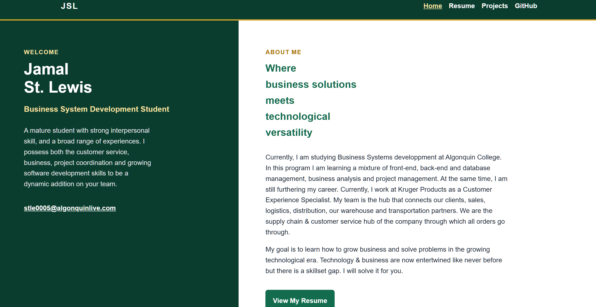
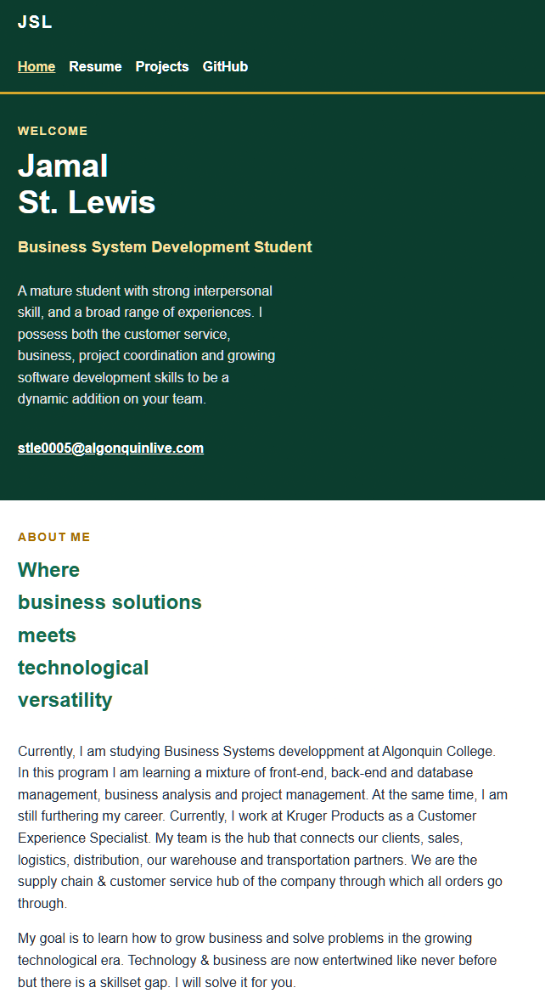
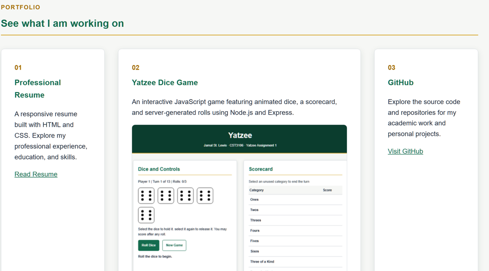
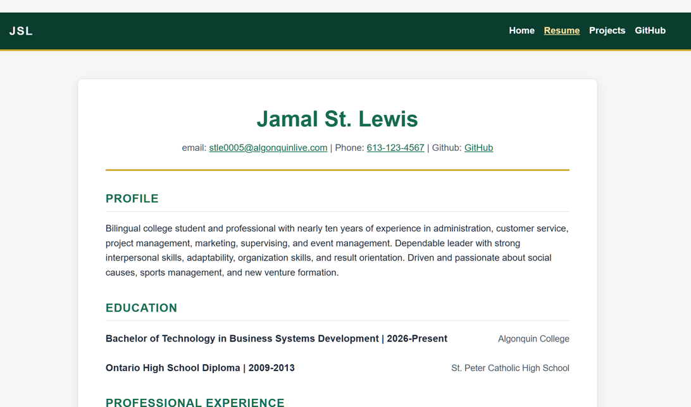
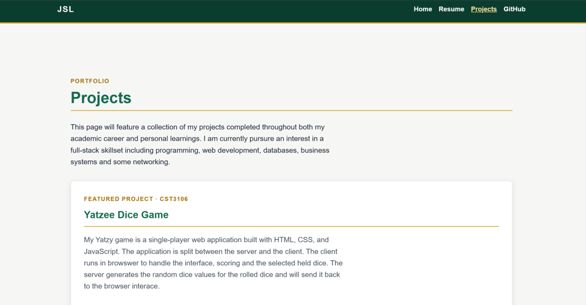

#Jamal St Lewis Portfolio Design System
## Purpose
This is for the design system for CST3106 portfolio website.

There are three pages:
1. Homepage
2. Resume Page
3. Projects Page

The goal is to create a modern & professional personal portfolio. It should be easily legible and higlight my
business & technology skills from my Bachelor of Technology - Business System Development program.

## Portfolio Repository

The actual portfolio should be available in the repository below:
 [Portfolio-Project](https://github.com/GauisCode/Portfolio-Project)

 ## Design Concept
A forest green and gold colour scheme trying to evoke the feelings of nature, clean, noble.

The goal is to implement the following design features:

- A split "hero" layout for the homepage
- The left side of the hero layout has an about me section
- present information in clear & distinct sections
- portfolio content introduced via rotating cards on the homepage
- portfolio page will provide a technical deep dive into the projects
- site layout adaption for smaller screens
- visible interactions states for links and button


### Design Inspiration
- Inspiration for the sidebar from https://brittanychiang.com/
- Feature cards inspired by https://paulsumido.com/ 
- Colour palette built using (https://coolors.co/?home)

** These websites provided inspiration but the content and component choices are solely my own. **

## Colour Palette

- Primary Colour: Dark Green (similar to a forest green)
- Accent colour: Gold
- Background colour: white/cream
For more specific details on the portfolio colours as per the stylesheet, see below: 
Legend:  Token | Hex value | Intended use |

|---|---:|---|
| `--green-dark` | `#0B3D2E` | Header, footer,  hero intro panel |
| `--green` | `#146C4E` | Headings, standard links, and primary buttons |
| `--green-hover` | `#0E513B` | Primary-button hover state |
| `--gold` | `#D4A72C` | Section borders and keyboard focus outline |
| `--gold-dark` | `#A66E00` | Project numbers and secondary-button text |
| `--gold-light` | `#FFF4D6` | Secondary-button hover background |
| `--text` | `#1F2937` | Main body text |
| `--muted` | `#4B5563` | Supporting text and footer text |
| `--page` | `#F6F7F5` | Outer page background |
| `--surface` | `#FFFFFF` | Hero content, cards, and resume background |
| `--border` | `#D1D5DB` | Card borders and content dividers |

### Colour Usage Guideline
- Green | Main visual structure
- Gold | Accent colour and tertiary font colour
- light text on dark-green surfaces and inverse for lighter surfaces
- multiple visual changes to highlight an interactive state

## Typography
- used the following font family: Aptos, Arial, Helvetica, sans-serif

| Element | Size | Intended Use |
| Main page heading | `2.35rem` | Main name and page titles |
| Main section heading | `1.5rem` | Homepage, projects-page, and major section titles |
| Card and resume-entry heading | `1.15rem` | Project, job, and education titles |
| Body text | `1rem` | Main paragraphs |
| Supporting text | `0.95rem` | Dates, tools, and footer text |

The site uses `line-height: 1.6` to make paragraphs and project descriptions more comfortable to read.

### Typography Guidelines
- H1 for Main Headings
- H2 for Section Headings
- H3 for subsection project headings
- headings in logical order
- will start to introduce code formatting for programming examples, filenames, class names, etc

## Card Style

Feature cards and the projects placeholder card use:

- White background
- 8px border radius
- Soft green-tinted shadow
- 24px to 32px internal padding
## Components

### Header and navigation

Each page uses the same dark-green header with a gold bottom border.

The navigation contains:

- Home
- Resume
- Projects
- GitHub

The active page uses aria-current='page', and highlights it in a lighter gold text colour and an underline. Navigation links also show hover and keyboard focus states.

### Homepage hero

The desktop homepage has two columns:

- A dark-green introduct panel on the left.
- A white About Me panel on the right.

The hero includes buttons for the Resume and Projects pages.
On a smaller screen, the homepage introduction will move above the above me section.

### Buttons

| Button | Appearance | Use |
|---|---|---|
| Primary button | Green background and white text | Main actions, such as “View My Resume” |
| Secondary button | White background with dark-gold border/text | Secondary actions, such as “View Projects” |

### Cards

Feature cards on homepage will introduce the portfolio contents.
They will have the same surface, border-radius, adn style components.

### Resume page

The resume uses the shared header and footer.
A flexible layout is used to separate different heading type components like job titles, organizations, and dates.
The details should stack in a readable, logical order on smaller/narrower screens.


### Projects page

A presentation of both academic and personal projects using my established style guidelines.
Each project will have the following a description, and a technical documentation with the following components:
- Project Description
- Project Progression
- Key Features
- Key Learning
- Technologies used
- Main files and their responsibilities
- Project Design
- Database/ Server implementation (if applicable)
- Accessbility Features
- Error Handling
- Source Code

Currently, the only project is on a Yatzy game.

The main HTML project-page classes include:

| Class | Responsibility |
|---|---|
| `.project-showcase` | Groups the complete project article |
| `.project-heading` | Groups the project title and introduction |
| `.project-summary` | Identifies the short project overview |
| `.project-description` | Groups the longer project introduction |
| `.project-details` | Groups related feature and learning sections |
| `.technology-list` | Identifies the list of technologies used |
| `.project-note` | Identifies supporting information about the project |

### Footer

Every page has a dark-green footer with a gold top border and copyright text: © 2026 Jamal St. Lewis · CST3106 Portfolio

## Responsive Layout

### Homepage Layout
At desktop widths, the homepage hero uses a two-column CSS Grid layout:

```css
.hero {
  display: grid;
  grid-template-columns: minmax(280px, 40%) minmax(0, 60%);
}
```

At widths of 800px or less, the page becomes a single-column layout:

```css
@media (max-width: 800px) {
  .hero {
    display: block;
  }

  .feature-grid {
    grid-template-columns: 1fr;
  }
}
```
### Smaller Screen Requirements


- Navigation links wrap as needed.
- The homepage introduction appears above the About Me content.
- Feature cards stack vertically.
- Resume title/date rows stack vertically.
- Padding is reduced to preserve readable content width.
- see below for visual in mockups

### Project Page Requirements

- screenshots within their container
- clear & close image captions
- content grouping
- wrap longer file names and links
- spacing to clearly separate content sections

## Accessibility and Interaction

The portfolio's accessibility design requirements include:

- Semantic page structure using elements such as `header`, `nav`,
  `main`, `article`, `section`, and `footer`.
- A logical heading hierarchy.
- Descriptive page titles.
- Descriptive link text.
- Alternative text for meaningful screenshots.
- Visible keyboard-focus indicators.
- Correct active-page navigation.
- Valid references between `aria-labelledby` and heading IDs.
- Readable text and background colour combinations.

** These above are accessibilty design features that should be implemented**

## Mock-ups

### Desktop Homepage Mock-up



The desktop version uses a dark-green and white split hero layout. It includes
shared navigation, a call-to-action button, and portfolio feature cards.

### Mobile Homepage Mock-up



The mobile version changes the desktop split hero into a single-column layout.
The navigation links wrap, and the content appears in a vertical reading order.

### Desktop Homepage FeatureCard Mock-up



The portfolio featurecard currently has a card with a github link, a resume blurb, and the Yatzy game.
### Resume page Mock-up



The resume page uses the shared dark-green navigation header, gold accent borders, and a white resume card for readable professional content.

### Projects page Mock-up



The projects page uses the shared navigation and page styling. It currently has the Yatzy game project showcase


## References


### Yatzy Game
- [CST3106 Lab 04 instructions](./ClassGuidelines/lab04_v3.pdf)
- [CST3106 Lab 05 instructions](./ClassGuidelines/lab05_v1.pdf)
- [CST30106 Lab 07 instructions](./ClassGuidelines/lab07_v1.pdf)
- [CST30106 Lab 08 instructions](./ClassGuidelines/lab08_v1.pdf)
- [CST30106 Assignment 1 instructions](./ClassGuidelines/assignment1.pdf)
- [CST30106 Assignment 2 instructions](./ClassGuidelines/Assignment2.pdf)
### Portfolio Design
- [CST30106 Project Deliverables 2](./ClassGuidelines/Project%20Deliverable%202.pdf)
- [Portfolio repository](https://github.com/GauisCode/Portfolio-Project)
- [Brittany Chiang — design inspiration](https://brittanychiang.com/)
- [Paul Sumido — design inspiration](https://paulsumido.com/)
- [Coolors — colour palette tool](https://coolors.co/?home)
- [MDN: Using CSS custom properties](https://developer.mozilla.org/en-US/docs/Web/CSS/Guides/Cascading_variables/Using_custom_properties)
- [WCAG 2.2: Contrast Minimum](https://www.w3.org/WAI/WCAG22/Understanding/contrast-minimum.html)
